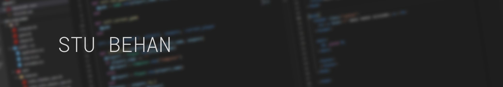

## Hi there 👋

I'm a lead software engineer at StackOne, an API and AI integrations platform, and most of my work now goes into making our API something an agent can use safely as well as a developer. That has meant owning our remote MCP platform and its OAuth, a good share of the policy engine that decides what an agent is allowed to do on someone's behalf, and the harness we use to build and test connectors with AI.

I also maintain stackvox, an open-source offline text-to-speech library on PyPI, and I'm one of the main contributors to stack-nudge, a macOS app that tells you when your coding agents have finished or need you. Both are on GitHub under StackOneHQ.

## Experience with:

## And these tools:

  

<a href="https://github.com/devicons/devicon">
 Icons by devicon
</a>

<!--
**StuBehan/StuBehan** is a ✨ _special_ ✨ repository because its `README.md` (this file) appears on your GitHub profile.

Here are some ideas to get you started:

- 🔭 I’m currently working on ...
- 🌱 I’m currently learning ...
- 👯 I’m looking to collaborate on ...
- 🤔 I’m looking for help with ...
- 💬 Ask me about ...
- 📫 How to reach me: ...
- 😄 Pronouns: ...
- ⚡ Fun fact: ...
-->
